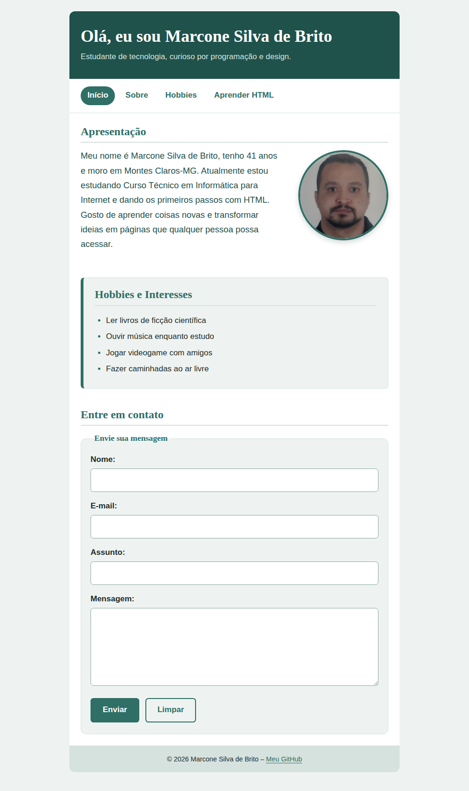

# Página Pessoal – Marcone Silva de Brito

Projeto da disciplina de Programação Web I: página pessoal com seções de apresentação, hobbies, navegação, rodapé e formulário de contato, estilizada com CSS externo.

## Estrutura

```
pagina-pessoal/
├── index.html
├── sobre.html
├── css/style.css
└── img/
    ├── foto.jpg
    └── captura-pagina.png
```

## Estilização com CSS

O arquivo `css/style.css` é vinculado a `index.html` e `sobre.html` pelo elemento `<link>`. Ele define cores (variáveis em `:root`), fontes, bordas, dimensões e espaçamentos, além de `:hover` nos links e botões. As classes `.intro` e `.secao-destacada` aplicam estilos específicos a elementos da página.

### Resultado no navegador



## Formulário "Entre em contato"

Campos: Nome, E-mail, Assunto e Mensagem, agrupados com `<fieldset>` e `<legend>`, com botões Enviar e Limpar.


